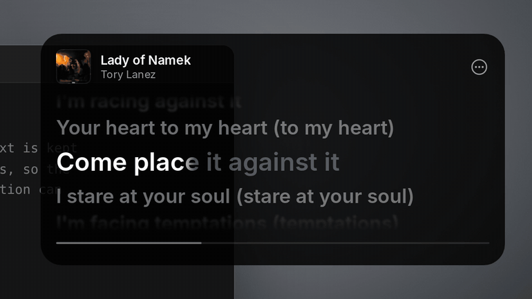

<div align="center">


# Singline

**Synced lyrics in a small window above everything else.**<br>
For Spotify, Apple Music, Amazon Music and YouTube Music, on Windows, macOS and Linux.

[](https://github.com/JulianRudrich/Singline/actions/workflows/ci.yml)
[](LICENSE)




</div>

> [!NOTE]
> Singline is in active development and has no stable release yet. Every change is tested on Linux with automated end-to-end tests, and every change on `main` produces a [test build](https://github.com/JulianRudrich/Singline/releases/tag/nightly) for Windows, macOS and Linux. The builds are not code-signed yet; [Install](#install) explains how to open them.

## Contents

[Features](#features) · [Supported players](#supported-players) · [Install](#install) · [Using Singline](#using-singline) · [In the terminal](#in-the-terminal) · [Where the lyrics come from](#where-the-lyrics-come-from) · [Privacy](#privacy) · [Troubleshooting](#troubleshooting) · [Building from source](#building-from-source) · [Roadmap](#roadmap) · [Contributing](#contributing) · [Credits](#credits) · [License](#license)

## Features

- **Follows what you play.** Singline reads the song and the playback position from your music app. It needs no login and no API key, and it never starts a player by itself. Let it follow whichever player is playing, or pick one.
- **Music in your browser.** YouTube Music, YouTube and other web players, even in a background tab, through the Singline extension for Chrome, Edge and Firefox. Music videos become clean song titles, so the right lyrics turn up.
- **Word by word.** Every word lights up as it is sung, from real word timing where the lyrics have it and estimated from the line timing otherwise. Between two readings of the player the position keeps running, so the highlight moves smoothly.
- **Lyrics in motion.** The lines scroll up as the song goes on, the next line grows into place, and breaks show three breathing dots. A new song fades in with its cover, title and artist.
- **A mini-player on hover.** Previous, play/pause and next, a seek bar with elapsed and remaining time, and markers for the chorus. Click any line to jump there.
- **Karaoke.** The lyrics fill a second screen or a TV, white on black: the current line lights up word by word, the next ones wait below it, breaks count down with three dots, and a long intro shows the cover, title and artist. Move the mouse for the controls.
- **Three layouts.** One line, Focus or Context, with adjustable font size, opacity, background, width and height. **Lyrics only** leaves out the song, the buttons and the timeline, even under the pointer.
- **Stays out of your way.** The overlay floats above other windows on every desktop and never takes the focus. With click-through it becomes a ghost that lets every click pass to the window below, and Alt+Shift+L (⌥⇧L on macOS) shows or hides it. Drag it anywhere or send it to a corner.
- **In your terminal.** The line being sung in the footer of pi, the coding agent, in your tmux status bar or in a terminal of its own, word by word, for coding with music.
- **A welcome that gets you started.** The first start shows where Singline lives, lets you choose your player, tells you as soon as Singline hears it and pairs the browser extension.
- **Timing you can correct.** If the lyrics run early or late, move them by a quarter of a second; Singline remembers the correction for that song. A global correction makes up for your audio setup, for example Bluetooth headphones.
- **Finds the right version.** Exact matches first, then a search that prefers the same album and versions with word timing. Plain lyrics are spread over the song and marked *~ not synced*; instrumentals are recognised.
- **Sing to find.** Don't know what's playing on the radio, or want lyrics to sing along to? Sing a few words: Singline recognises them on your computer, finds the song, shows its lyrics from the line you sang and keeps up while you go on singing. Your voice never leaves your computer.
- **Your own lyrics.** Import an LRC file, or paste the lyrics into the editor and set each line's timestamp with a key press while the song plays. Your lyrics always win.
- **Your music.** Listening time, plays, your daily streak, skips, a listening clock, and your most played songs and artists, from every player, kept only on your device.
- **Sleep timer and auto-hide.** Pause the music after 15 to 60 minutes or at the end of the song, and let the overlay disappear while nothing plays.
- **Spotify extras, if you want them.** Connect your own Spotify app to like the current song with ♥, see your top artists and tracks, and use **True Shuffle**: an honest random order through your Liked Songs, playlists and mixes in which nothing repeats until everything has played. Needs Spotify Premium.
- **Works offline.** Lyrics are cached on your device, so songs you have heard before work without a connection.
- **Private.** No account, no tracking, no analytics. Only the song's title, artist, album and duration leave your computer, to look up lyrics, and you can turn that off. Sing to find sends only the words it heard, never audio.
- **English and German**, following your system language.


| One line | Focus | Context |
|:-:|:-:|:-:|
|  |  |  |

<p align="center"><br><sub>Karaoke mode for a second screen or a TV.</sub></p>

| Mini-player | Lyrics only |
|:-:|:-:|
|  |  |
| Move the pointer over the overlay for the controls. | Nothing but the lyrics, even under the pointer. |


<p align="center"><br><sub>The welcome at the first start.</sub></p>

## Supported players

| | Windows | macOS | Linux |
|---|---|---|---|
| **Spotify** | Desktop app | Desktop app | Desktop app |
| **Apple Music** | Apple Music app | Music app | Web player ¹ ³ |
| **Amazon Music** | Desktop app ² | Web player ³ | Web player ¹ ³ |
| **YouTube Music** | Web app, or a browser tab ³ | Browser tab ³ | Browser tab ¹ ³ |
| **YouTube and other web players** | Browser tab ³ ⁴ | Browser tab ³ ⁴ | Browser tab ³ ⁴ |
| **Other media players** | Players that report to the system media controls ⁴ | – | Any MPRIS player, such as VLC ⁴ |

1. On Linux, Singline recognises these sites even without the extension when the browser shares the page address, as Firefox does.
2. Some versions of Amazon Music for Windows report only part of the song information.
3. With the [Singline browser extension](extensions/browser) for Chrome, Edge and Firefox. A tab keeps working in the background.
4. Turn on **Also follow other players** in Settings → General. Singline turns a video's title into song and artist: "Artist - Song (Official Video)" becomes "Song" by "Artist".

On Linux, Singline reads players through MPRIS, on Windows through the system media controls, on macOS through AppleScript, and in the browser through its extension.

## Install

### Test builds

Every change on `main` produces a test build for all three systems. The newest one is always on the [test build release](https://github.com/JulianRudrich/Singline/releases/tag/nightly), with no GitHub account needed:

1. Download the file for your system:
   - **macOS:** `Singline-macOS.dmg`, a universal app for Apple silicon and Intel Macs
   - **Windows:** `Singline-Windows-setup.exe`
   - **Linux:** `Singline-Linux.AppImage` for any distribution, or `Singline-Linux.deb` for Debian and Ubuntu
2. Install it. The builds are not signed yet:
   - **Windows:** if SmartScreen stops the installer, choose **More info** → **Run anyway**. Windows releases are to be signed through the SignPath Foundation; see the [code signing policy](docs/CODE_SIGNING_POLICY.md).
   - **macOS:** if macOS refuses to open the app, go to **System Settings → Privacy & Security** and choose **Open Anyway** (on macOS 14 and earlier, right-click the app and choose **Open**). When you play music, allow Singline to control Spotify or Music.
   - **Linux:** install the package with `sudo apt install ./Singline-Linux.deb`, or make the AppImage executable with `chmod +x Singline-Linux.AppImage` and start it. If the AppImage does not start, install FUSE 2: `sudo apt install libfuse2t64` on Ubuntu 24.04 and later, `sudo apt install libfuse2` on older versions.

Every build of `main` is also under [Actions](https://github.com/JulianRudrich/Singline/actions/workflows/ci.yml?query=branch%3Amain+is%3Asuccess), for signed-in GitHub users, together with `singline-watch`, a small tool that shows what your players report (see [Troubleshooting](#troubleshooting)).

### Browser extension

The extension lets Singline follow YouTube Music, YouTube and other web players in Chrome, Edge and Firefox, even in a background tab. Until it is in the browser stores, load it from the folder [`extensions/browser`](extensions/browser). Download [the repository as a ZIP file](https://github.com/JulianRudrich/Singline/archive/refs/heads/main.zip) and unpack it. Then:

- **Chrome and Edge:** open `chrome://extensions` (or `edge://extensions`), turn on **Developer mode**, click **Load unpacked** and choose `extensions/browser`.
- **Firefox 128 or later:** open `about:debugging#/runtime/this-firefox`, click **Load Temporary Add-on…** and choose `extensions/browser/manifest.json`.

Then pair it once: Settings → General → **Browser extension** shows a six-digit code; type it into the extension's popup and click **Pair**. The [extension's README](extensions/browser/README.md) has the details.

### Uninstall

Turn off Settings → General → **Open at login** first, then:

- **Windows:** Settings → Apps → Installed apps → Singline → **Uninstall**.
- **macOS:** quit Singline and move it from Applications to the Trash.
- **Linux:** `sudo apt remove singline` for the package, or delete the AppImage.

Your settings, lyrics and listening history stay behind; delete the folders listed under [Privacy](#privacy) to remove them too.

### The native macOS app

[`apps/macos`](apps/macos) contains the original macOS app, written in Swift, with the features contributed from Linory. It remains available until Singline has been tested on every system. See its [README](apps/macos/README.md).

## Using Singline

Start Singline and play a song. Singline sits in the system tray (the menu bar on macOS) and shows the lyrics as soon as it finds them. On macOS it also appears in the Dock while one of its windows, such as the settings, is open.

At the first start, a short welcome shows where Singline lives, lets you choose your player and tells you when Singline hears it, and pairs the browser extension.

| To … | do this |
|---|---|
| Show or hide the overlay | Press **Alt+Shift+L** (**⌥⇧L** on macOS), or use the tray menu |
| Move the overlay | Drag it, or choose a corner in the tray menu under **Position** |
| Show nothing but the lyrics | Turn on **Lyrics only** in the tray menu or under Settings → Appearance: no song, buttons, microphone or timeline |
| Click the window behind the overlay | Turn on **Click-through** in the tray menu or under Settings → Appearance; opening Singline again turns it off |
| Open the settings | Click the note in the overlay, choose **Settings…** in the tray menu, or open Singline again while it runs |
| Fix the timing of a song | Settings → Song & timing → **−0.25** / **+0.25** (remembered per song) |
| Fix the timing of all songs | Settings → Song & timing → **Global timing correction** |
| Choose the player to follow | Tray menu → **Playback source**, or Settings → General |
| Follow browsers and other players | Settings → General → **Also follow other players** |
| Pair the browser extension | Type the code from Settings → General → **Browser extension** into the extension's popup |
| Control the player | Move the pointer over the overlay for previous, play/pause, next and the seek bar |
| Jump to a line or the chorus | Click the line, or a chorus marker on the seek bar |
| Add your own lyrics | Settings → Song & timing → **Import LRC…** or **Edit lyrics…** |
| Set a timestamp in the editor | Press **Ctrl+Shift+T** (**⌘⇧T** on macOS) while the line is sung |
| Pause the music later | Tray menu → **Sleep timer** |
| Connect Spotify | Settings → **Spotify**: follow the four steps, then press **Connect Spotify** |
| Like the current song | Click ♥ next to the controls (Spotify connected) |
| Start True Shuffle | Tray menu → **True Shuffle…** |
| Sing along on a big screen | Tray menu → **Karaoke**; pick another display in its controls. Space plays or pauses, ← / → jump 5 seconds, ↑ / ↓ move the lyrics by a quarter second, and Esc or the shortcut leaves |
| See your listening statistics | Tray menu → **Your music…** |
| Find a song by singing it | Tray menu → **Sing to find…**, or the microphone in the overlay's corner, then sing a line |
| Hide the microphone | Turn off Settings → General → **Sing to find**; the overlay and the menus then leave it out |
| Say a found song is the wrong one | Click **Not this song** above the lyrics, or ↻ to listen again |
| Hide the overlay while nothing plays | Settings → General → **Hide when nothing is playing** |
| Search a song's lyrics again | Click the retry button that appears when a search fails |
| See Singline without playing music | Start it with `--demo` |
| Quit Singline | Tray menu → **Quit**, or **Quit Singline** at the bottom of the settings |

Positive corrections show the lyrics earlier, negative ones later. The global and the per-song correction add up.

## In the terminal

Coding with music? Singline brings the line being sung into your terminal. The Singline app has to run: it keeps `now.json` up to date in its cache folder, and nothing leaves your computer.

**pi.** The [Singline extension for pi](extensions/pi) shows the line in pi's footer, lighting up word by word, in any terminal such as Kitty, WezTerm or Ghostty:

```bash
mkdir -p ~/.pi/agent/extensions
```

```bash
curl -fsSL https://raw.githubusercontent.com/JulianRudrich/Singline/main/extensions/pi/singline.ts -o ~/.pi/agent/extensions/singline.ts
```

Then start pi, or run `/reload` in a running one. `/singline` shows or hides the lyrics.

**A terminal of its own.** `singline lyrics` fills a terminal, or a tmux pane next to your code, with the lyrics: the line being sung in the middle, lighting up letter by letter as it is sung, the lines around it fading with distance, and the time at the bottom. It takes its colours from your terminal's theme, dark or light. q leaves.

<p align="center"></p>

**tmux and other status lines.** `singline now` prints the current line, the song between two lines, and nothing while no song plays. `--format` chooses what to print, with `{line}`, `{next}`, `{title}`, `{artist}`, `{album}` and `{player}`. For tmux, add this to `~/.tmux.conf`:

```tmux
set -g status-interval 1
set -g status-right '#(singline now)'
```

On macOS the command lives inside the app, at `/Applications/Singline.app/Contents/MacOS/singline`. To call it `singline`, link it once:

```bash
sudo mkdir -p /usr/local/bin
```

```bash
sudo ln -sf /Applications/Singline.app/Contents/MacOS/singline /usr/local/bin/singline
```

`singline now` and `singline lyrics` work on macOS and Linux. On Windows, use the pi extension.

## Where the lyrics come from

1. **Your own lyrics**, imported from an LRC file (UTF-8, up to 512 KB) or written in the editor. They are kept on your device and win over everything else.
2. **The local cache.** Lyrics found earlier are remembered, so they appear instantly and work offline.
3. **[LRCLIB](https://lrclib.net)**, a free, open lyrics database. Singline first asks for the exact recording (title, artist, album and a duration within a few seconds), then searches and prefers the same album and versions with word timing.

How often word timing is available varies by song. In a sample of ten popular songs on LRCLIB, eight had at least one version with word timing.

For **Sing to find**, Whisper first turns your singing into words on your computer. [Genius](https://genius.com) finds the songs those words belong to, since LRCLIB cannot search lyrics. Singline then loads the lyrics of the best candidates the usual way (your own lyrics, the cache, LRCLIB), picks the song whose lyrics match what you sang, and starts at the line you sang. While you keep singing, it listens again every few seconds and keeps the lyrics with you. Songs that LRCLIB has only without timing cannot be followed.

## Privacy

- Singline has no account, no telemetry and no analytics.
- To find lyrics, Singline sends the title, artist, album and duration of the song you are playing to LRCLIB. Turn off **Search lyrics online** in Settings → Song & timing to keep everything on your device.
- The browser extension talks only to Singline on your own computer (`127.0.0.1`), and only after you paired it. Web pages and other programs without the pairing are refused.
- Your listening history never leaves your device. Turn it off or clear it at the bottom of the **Your music** window; cleared entries are overwritten on disk.
- Sing to find runs only while you use it. The audio stays in memory on your computer and is transcribed there by [Whisper](https://github.com/ggerganov/whisper.cpp); the speech model (about 150 MB) is downloaded once from Hugging Face into the data folder. Only the words it heard go to Genius, to find the song, and the found title and artist to LRCLIB. It needs **Search lyrics online**.
- The Spotify connection is optional. It uses your own Spotify app, keeps the login in the system's credential store (Keychain, Credential Manager or Secret Service), and talks to Spotify only while you are connected.
- The log file stays on your device and is only sent when you submit an issue from **Report a problem** yourself.
- Your settings are stored in `settings.json`. The cache, your timing corrections, your own lyrics and your listening history are stored in `singline.sqlite`. Deleting these files resets Singline.

| System | Location |
|---|---|
| Windows | `%APPDATA%\io.github.julianrudrich.singline` |
| macOS | `~/Library/Application Support/io.github.julianrudrich.singline` |
| Linux | `~/.config/io.github.julianrudrich.singline` (settings) and `~/.local/share/io.github.julianrudrich.singline` (data) |

## Troubleshooting

**Singline is not in the Dock on macOS.** Singline lives in the menu bar: look for the icon with three lines near the clock. It joins the Dock, the app switcher and Force Quit while one of its windows is open. Open Singline again from Applications, Launchpad or Spotlight to bring up the settings, where **Quit Singline** sits at the bottom. On a MacBook with a notch, macOS hides the menu bar icons that do not fit beside it; quit a few other menu bar apps to make room, or turn on Settings → General → **Show in Dock** to keep Singline in the Dock, where a click opens the settings.

**macOS says Singline is damaged and cannot be opened.** macOS says this about some apps from the internet that are not signed by Apple, which the test builds are not yet. After moving Singline to Applications, remove the download mark in Terminal and open it again:

```bash
xattr -dr com.apple.quarantine /Applications/Singline.app
```

**macOS says to allow access in System Settings.** Singline asks Spotify and Music for the current song through Apple Events. Turn on Singline under **System Settings → Privacy & Security → Automation**.

**Sing to find cannot hear you.** Allow Singline to use the microphone: on macOS under **System Settings → Privacy & Security → Microphone**, on Windows under **Settings → Privacy & security → Microphone → Let desktop apps access your microphone**. On Linux, check that the microphone is the chosen input and not muted. Singline says which of these it is.

**Sing to find needs a Genius token.** Builds from source have none. Create a free API client at [genius.com/api-clients](https://genius.com/api-clients), generate an access token and paste the **Client Access Token** in Settings → General → **Sing to find**.

**Sing to find says the processor is too old.** Its speech recognition needs a processor with AVX2, as Intel Core processors have since 2013, AMD processors since 2015 and every Mac with Apple silicon. Many Celeron, Pentium and Atom processors lack it. Everything else in Singline works without it.

**The lyrics are early or late.** Correct the song with −0.25 / +0.25. If every song is off by the same amount, which is typical for Bluetooth headphones, use the global correction instead.

**Spotify cannot connect.** Check that the redirect URI in your Spotify app is exactly `http://127.0.0.1:43821/callback`, and that no other app uses port 43821. Spotify only lets accounts with Premium use apps in development mode.

**No lyrics found.** LRCLIB does not know the song yet, or knows it only without timing. Click the retry button to search again later.

**The player does not report the playback position.** Without a position the lyrics cannot follow. This depends on the player; Singline tells you which one it is.

**Alt+Shift+L does nothing.** Another app already uses the shortcut, and Settings says so. Show or hide the overlay from the tray menu instead. On Linux the shortcut currently works on X11 only.

**The overlay does not stay on top on Linux (Wayland).** GNOME does not let apps keep normal windows on top under Wayland. Start Singline with `GDK_BACKEND=x11` so it runs through XWayland.

**Find out what your player reports.** `singline-watch` prints live what every player on your computer reports: title, artist, album, position, how far the position drifts, and which controls it offers. The builds under [Actions](https://github.com/JulianRudrich/Singline/actions/workflows/ci.yml?query=branch%3Amain+is%3Asuccess) and every release include it; from source, run:

```bash
cargo run --release -p media-session --bin singline-watch
```

Please include its output when you [report a problem](https://github.com/JulianRudrich/Singline/issues/new?template=bug_report.yml).

**Report a problem.** Settings → About → **Report a problem** opens a pre-filled issue on GitHub with the Singline version, your system, the player and the last lines of the log. You see everything before you send it. **Show** next to **Log file** shows the log itself; the one before it is kept as `singline.old.log`.

| System | Log file |
|---|---|
| Windows | `%LOCALAPPDATA%\io.github.julianrudrich.singline\logs\singline.log` |
| macOS | `~/Library/Logs/io.github.julianrudrich.singline/singline.log` |
| Linux | `~/.local/share/io.github.julianrudrich.singline/logs/singline.log` |

## Building from source

You need Rust 1.88 or later, Node.js 22 and pnpm 10, plus CMake, a C++ compiler and libclang for whisper.cpp, which Sing to find uses (on macOS the Xcode command line tools, on Windows Visual Studio's C++ tools and LLVM). On Linux you also need the WebKitGTK and ALSA development files; on Debian and Ubuntu:

```bash
sudo apt install libwebkit2gtk-4.1-dev libgtk-3-dev libayatana-appindicator3-dev librsvg2-dev libxdo-dev libasound2-dev libclang-dev cmake
```

To build without Sing to find, and so without CMake and libclang, pass `--no-default-features` to Cargo for the app.

Install the dependencies:

```bash
pnpm install
```

Run Singline in development mode, with the interface reloading on every change:

```bash
pnpm dev
```

Build a debug version and start it with the built-in sample song:

```bash
pnpm --filter singline-desktop tauri build --debug --no-bundle
```

```bash
./target/debug/singline --demo
```

Build the installers for your system:

```bash
pnpm build
```

### Checks

Every change has to pass these checks, which CI runs as well:

```bash
cargo fmt --all --check
```

```bash
cargo clippy --workspace --all-targets -- -D warnings
```

```bash
pnpm --filter singline-desktop check
```

```bash
pnpm --filter singline-desktop test
```

```bash
cargo test --workspace
```

```bash
node --test "extensions/browser/test/*.test.js"
```

```bash
bash apps/desktop/e2e/linux-smoke.sh
```

```bash
bash apps/desktop/e2e/linux-youtube.sh
```

```bash
bash apps/desktop/e2e/linux-sing.sh
```

`cargo test --workspace` needs the built interface (`pnpm --filter singline-desktop build`); a plain `cargo test` covers the crates only. The end-to-end check starts the app on a virtual display with a simulated Spotify and a simulated LRCLIB, and compares every line the overlay shows with the playback time. The check for Sing to find plays lines synthesized with espeak-ng instead of the microphone and needs a Whisper model; the top of [`linux-sing.sh`](apps/desktop/e2e/linux-sing.sh) says how to get one, and without it the check is skipped.

### Environment variables for development

| Variable | Effect |
|---|---|
| `SINGLINE_DATA_DIR` | Keeps settings, data and the log in this folder instead of the system location |
| `SINGLINE_LRCLIB_URL` | Uses another LRCLIB server, for example a local test server |
| `SINGLINE_DEBUG` | Makes the overlay report every line it shows, for end-to-end checks, and writes debug lines to the log. With it, `--karaoke` and `--menu-panel` open karaoke and the tray panel, at start or from a second launch |
| `SINGLINE_SPOTIFY_ACCOUNTS_URL`, `SINGLINE_SPOTIFY_API_URL` | Use other Spotify servers, for example local test servers |
| `SINGLINE_GENIUS_TOKEN` | At build time: a Genius token built into the app, so Sing to find works without setup |
| `SINGLINE_GENIUS_URL` | Uses another Genius API server, for example a local test server |
| `SINGLINE_MIC_FILE` | Sing to find hears this WAV file instead of the microphone, and starts by itself |
| `SINGLINE_WHISPER_MODEL` | Uses this Whisper model file instead of downloading one |
| `SINGLINE_WHISPER_MODEL_URL` | Downloads the Whisper model from another server |

### Project structure

| Path | Contents |
|---|---|
| [`crates/lyrics-core`](crates/lyrics-core) | Lyrics logic without input or output: LRC and Lyricsfile parsing with word timing, matching, the playback clock, choosing a player |
| [`crates/media-session`](crates/media-session) | Reading and controlling players through MPRIS, the Windows media controls and AppleScript, plus `singline-watch` |
| [`crates/spotify-connect`](crates/spotify-connect) | The optional Spotify connection: login, Web API client and True Shuffle |
| [`crates/lyrics-providers`](crates/lyrics-providers) | The LRCLIB client and the SQLite store for your own lyrics, corrections and the cache, and the song search for Sing to find (Genius) |
| [`crates/transcription`](crates/transcription) | Sing to find: microphone capture, voice detection, the Whisper model download and transcription on the device |
| [`apps/desktop`](apps/desktop) | The Singline app: Tauri and Rust in `src-tauri`, the Svelte interface in `src`, the end-to-end test in `e2e` |
| [`extensions/browser`](extensions/browser) | The browser extension for web players, for Chrome, Edge and Firefox |
| [`apps/macos`](apps/macos) | The native macOS app in Swift |
| [`docs`](docs) | Roadmap, feature parity, test guide and measurements |

## Roadmap

**Done recently**

- Your own lyrics with LRC import and an editor with a timestamp key
- The mini-player with seek bar, chorus markers and jumping to a line, cover art, scrolling lines and an estimated word highlight
- Sleep timer, hiding the overlay while nothing plays, and listening statistics
- Settings in the glass design of the native macOS app, with a sidebar
- YouTube Music and other web players on every system through the browser extension
- Spotify connection for True Shuffle, liking songs and your top lists
- Sing to find: recognising a song from a few sung words and following the singer

**In progress**

- A glass menu panel from the tray icon with the current song, and a configurable shortcut
- The browser extension in the Chrome Web Store and on Firefox Add-ons

**Later**

- Installers with automatic updates, signed builds, and packages for winget, Homebrew, Flathub and the AUR
- More lyrics sources, a choice between versions, an editor for word timing, and publishing your lyrics to LRCLIB
- A delay per audio output, translations, themes and a mode for streaming with OBS

The detailed plan is in [docs/ROADMAP.md](docs/ROADMAP.md), and [docs/PARITY.md](docs/PARITY.md) tracks every feature on every system.

## Contributing

Bug reports, translations and pull requests are welcome. [CONTRIBUTING.md](CONTRIBUTING.md) explains how to get started, and the [code of conduct](CODE_OF_CONDUCT.md) applies to everyone. Please report security problems privately, as described in [SECURITY.md](SECURITY.md).

## Credits

- [Mike Fox](https://github.com/MikeLeonFox) built Linory, a macOS fork of this project, and contributed all of its features back in [#1](https://github.com/JulianRudrich/Singline/pull/1). Singline brings them to every system.
- Lyrics come from [LRCLIB](https://lrclib.net), the open lyrics database created by [tranxuanthang](https://github.com/tranxuanthang) and filled by its community.
- Singline is built with [Tauri](https://tauri.app), [Rust](https://www.rust-lang.org) and [Svelte](https://svelte.dev).

## License

Singline is free software under the [GNU General Public License v3.0 or later](LICENSE). The native macOS app in [`apps/macos`](apps/macos) and releases up to 0.1.0 are available under the [MIT License](apps/macos/LICENSE).

Song lyrics belong to their rights holders. Singline is not affiliated with Spotify, Apple, Amazon, Google or LRCLIB.
